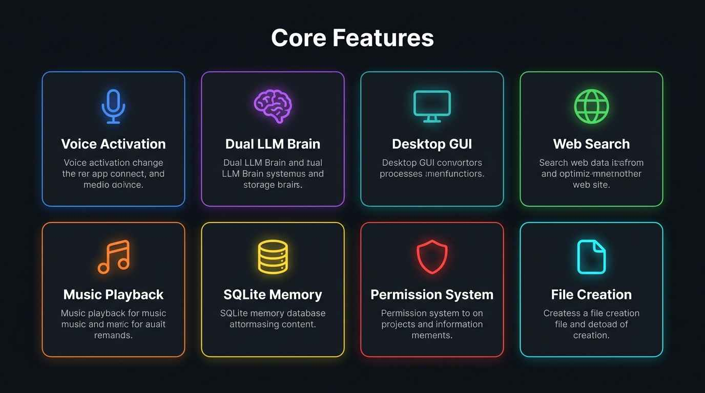
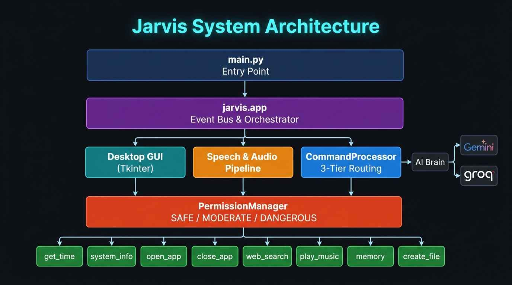
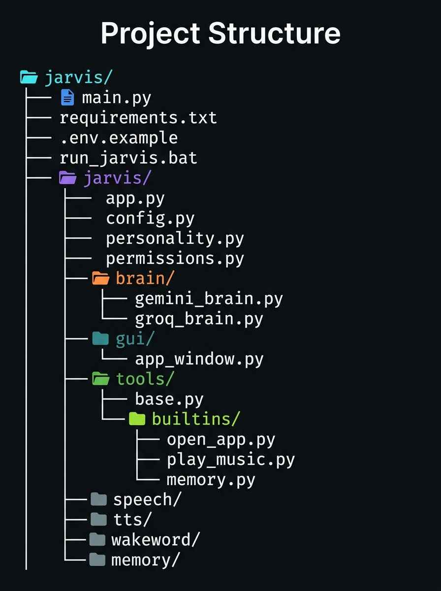
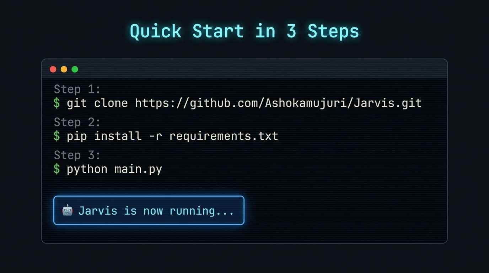

<div align="center">


<br/>


<br/>

> **A modular, voice-activated personal AI assistant for Windows**  
> *Speak to your PC. Jarvis listens, thinks, and acts.*

<br/>

[🚀 Quick Start](#-quick-start) · [✨ Features](#-features) · [🏛️ Architecture](#%EF%B8%8F-architecture) · [🛠️ Add a Tool](#%EF%B8%8F-adding-a-custom-tool) · [⚙️ Configuration](#%EF%B8%8F-configuration-reference)

</div>

---

## 🌟 Overview

**Jarvis** is a fully local, extensible personal AI assistant that runs on Windows. It combines:

- 🎤 **Wake-word voice recognition** — say *"Hey Jarvis"* and go
- 🧠 **Dual LLM brain** — Google Gemini *or* Groq, switchable via `.env`
- 🖼️ **Desktop GUI** — polished Tkinter interface with real-time status
- 🛡️ **Permission system** — tiered risk levels protect sensitive operations
- 💾 **SQLite memory** — Jarvis remembers facts between sessions
- 🎵 **Music & browser control** — YouTube, Spotify, Google via Chrome CDP

All in a clean, modular Python package — built to be extended.

---

## ✨ Features



<br/>

| Feature | Description |
|---|---|
| 🎤 **Voice Activation** | Wake-word "Hey Jarvis" + inline command execution |
| 🧠 **Dual LLM Brain** | Google Gemini 2.5 Flash or Groq — switchable in `.env` |
| 🖥️ **Desktop GUI** | Tkinter UI with status badges, chat history, listen toggle |
| 🖥️ **App Control** | Launch & close Windows apps by voice (Chrome, VS Code, etc.) |
| 🌐 **Web Search** | Google search + direct site navigation via Chrome |
| 🎵 **Music Playback** | YouTube/Spotify via Chrome CDP with smart tab reuse |
| 💾 **SQLite Memory** | Store, recall, search, and delete personal facts locally |
| 🛡️ **Permission System** | SAFE / MODERATE / DANGEROUS / BLOCKED risk tiers |
| 📂 **File Creation** | Create files by voice with risk-aware confirmation |
| 🔇 **Offline TTS** | Windows SAPI5 voice via `pyttsx3` — no internet needed |

---

## 🏛️ Architecture



<br/>

### Module Responsibilities

| Module | File | Purpose |
|---|---|---|
| **App Orchestrator** | [`jarvis/app.py`](jarvis/app.py) | Coordinates all subsystems, event bus for UI decoupling |
| **GUI Layer** | [`jarvis/gui/`](jarvis/gui/) | Tkinter desktop UI with indicators & chat history |
| **Command Processor** | [`jarvis/commands/`](jarvis/commands/) | 3-tier routing: system → tools → LLM brain |
| **Tool Framework** | [`jarvis/tools/`](jarvis/tools/) | `BaseTool`, `ToolRegistry`, `SafeExecutor` |
| **Permissions** | [`jarvis/permissions.py`](jarvis/permissions.py) | `RiskLevel` tiers & voice confirmation callbacks |
| **Memory Store** | [`jarvis/memory/`](jarvis/memory/) | SQLite persistence — facts, conversations, tasks |
| **AI Brain** | [`jarvis/brain/`](jarvis/brain/) | Gemini (`gemini_brain.py`) + Groq (`groq_brain.py`) |
| **Personality** | [`jarvis/personality.py`](jarvis/personality.py) | System prompt — character tone & speech rules |
| **Speech Input** | [`jarvis/speech/`](jarvis/speech/) | Microphone capture + Google Speech Recognition |
| **Wake Word** | [`jarvis/wakeword/`](jarvis/wakeword/) | "Hey Jarvis" detection + inline command extraction |
| **Voice Output** | [`jarvis/tts/`](jarvis/tts/) | Offline SAPI5 TTS via `pyttsx3` |
| **Utilities** | [`jarvis/utils/`](jarvis/utils/) | Phrase matching, arg parsing, text sanitization |

---

## 📁 Project Structure

<div align="center">



</div>

<br/>

```
Jarvis/
├── main.py                    # Entry point  (--gui / --cli)
├── requirements.txt           # Python dependencies
├── .env.example               # Configuration template
├── run_jarvis.bat             # Windows one-click launcher
├── assets/                    # README images
└── jarvis/
    ├── app.py                 # Core orchestrator & event bus
    ├── config.py              # Centralized config (.env loader)
    ├── personality.py         # AI character & system prompt
    ├── permissions.py         # RiskLevel & permission manager
    ├── logger.py              # Logging setup
    ├── brain/                 # LLM providers
    │   ├── gemini_brain.py    #  → Google Gemini
    │   └── groq_brain.py      #  → Groq
    ├── commands/              # 3-tier command processor
    ├── gui/                   # Tkinter desktop interface
    ├── memory/                # SQLite store (facts, tasks, prefs)
    ├── speech/                # Speech recognition
    ├── tts/                   # pyttsx3 TTS
    ├── wakeword/              # Wake-word detection
    ├── tools/
    │   ├── base.py            # BaseTool + ToolResult
    │   ├── registry.py        # ToolRegistry
    │   ├── executor.py        # SafeExecutor
    │   └── builtins/
    │       ├── get_time.py
    │       ├── system_info.py
    │       ├── open_app.py
    │       ├── close_app.py
    │       ├── web_search.py
    │       ├── play_music.py
    │       ├── memory.py
    │       └── create_file.py
    └── utils/                 # Shared utilities
```

---

## 🚀 Quick Start



<br/>

### 1. Prerequisites

- **Python** 3.10 or later
- **Windows** 10 / 11
- A **microphone** *(optional — text input works without one)*
- A **Gemini** or **Groq** API key *(optional — built-in tools work without LLM)*

### 2. Clone & Install

```powershell
git clone https://github.com/Ashokamujuri/Jarvis.git
cd Jarvis
pip install -r requirements.txt
```

### 3. Configure

```powershell
copy .env.example .env
```

Edit `.env` and set your API key:

```env
# Choose provider: "gemini" or "groq"
JARVIS_BRAIN_PROVIDER=gemini

# Google Gemini → https://aistudio.google.com/apikey
GEMINI_API_KEY=your_gemini_api_key_here

# OR Groq → https://console.groq.com/keys
GROQ_API_KEY=your_groq_api_key_here
```

### 4. Launch

```powershell
python main.py          # Desktop GUI (default)
python main.py --cli    # Terminal / CLI mode
```

> **Tip:** Double-click `run_jarvis.bat` to launch the GUI instantly on Windows.

---

## 🛡️ Permission System

Jarvis uses a 4-tier risk system to keep operations safe:

| Risk Level | Color | Behavior | Examples |
|---|---|---|---|
| `SAFE` | 🟢 Green | Runs immediately | Get time, system info |
| `MODERATE` | 🟡 Yellow | Asks for voice confirmation | Open apps, clear memories |
| `DANGEROUS` | 🔴 Red | Requires explicit "yes", auto-denied headless | Destructive operations |
| `BLOCKED` | ⛔ Black | Always denied | Permanently blocked actions |

---

## 🛠️ Adding a Custom Tool

All tools subclass [`BaseTool`](jarvis/tools/base.py) — it's just 3 steps:

**Step 1 — Create** `jarvis/tools/builtins/weather.py`:

```python
from jarvis.permissions import RiskLevel
from jarvis.tools.base import BaseTool, ToolResult

class WeatherTool(BaseTool):
    name        = "get_weather"
    description = "Checks the current weather forecast."
    risk_level  = RiskLevel.SAFE
    keywords    = {"weather", "forecast", "temperature", "is it raining"}

    def action_summary(self, raw_text: str) -> str:
        return "check the local weather"

    def execute(self, raw_text: str) -> ToolResult:
        return ToolResult(
            success=True,
            message="It's currently clear and 72°F.",
            data={"temp": 72, "condition": "clear"}
        )
```

**Step 2 — Register** in [`jarvis/tools/builtins/__init__.py`](jarvis/tools/builtins/__init__.py):

```python
from jarvis.tools.builtins.weather import WeatherTool

def register_all(registry):
    registry.register(WeatherTool())
    # ... other tools
```

**Done!** Your tool is now automatically routed, permission-checked, listed in `help`, and available in both GUI and CLI modes.

---

## ⚙️ Configuration Reference

All settings live in `.env` (copy from `.env.example`):

| Variable | Default | Description |
|---|---|---|
| `JARVIS_BRAIN_PROVIDER` | `gemini` | LLM backend: `gemini` or `groq` |
| `GEMINI_API_KEY` | — | Google Gemini API key |
| `GROQ_API_KEY` | — | Groq API key |
| `JARVIS_GEMINI_MODEL` | `gemini-2.5-flash` | Gemini model name |
| `JARVIS_GROQ_MODEL` | `qwen/qwen3.8-27b` | Groq model name |
| `JARVIS_WAKE_WORD` | `hey jarvis` | Custom wake-word phrase |
| `JARVIS_WAKE_WORD_ENABLED` | `true` | Enable/disable wake-word |
| `JARVIS_SPEECH_LANGUAGE` | `en-US` | Speech recognition locale |
| `JARVIS_SPEECH_TIMEOUT` | `5` | Seconds to wait for speech |
| `JARVIS_TTS_RATE` | `175` | TTS speaking speed (words/min) |
| `JARVIS_TTS_VOLUME` | `1.0` | TTS volume (0.0 – 1.0) |
| `JARVIS_LOG_LEVEL` | `INFO` | Logging verbosity |

---

## ⚠️ Known Limitations

1. **Online Speech Recognition** — Uses Google's free web API, so an active internet connection is required. Offline alternatives (Vosk, Porcupine) are supported via base classes.
2. **API Rate Limits** — If the LLM provider is rate-limited, Jarvis continues with built-in tools and system commands.
3. **Windows Platform** — App launch paths, URI schemes (`ms-settings:`), and `pyttsx3` TTS are Windows-optimized.

---

## 📄 License

This project is licensed under the **MIT License** — see [LICENSE](LICENSE) for details.

---

<div align="center">

**Made with ❤️ by [Ashok](https://github.com/Ashokamujuri)**

*Built to be extended. Built to be spoken to.*

⭐ **Star the repo if you find it useful!** ⭐

</div>
